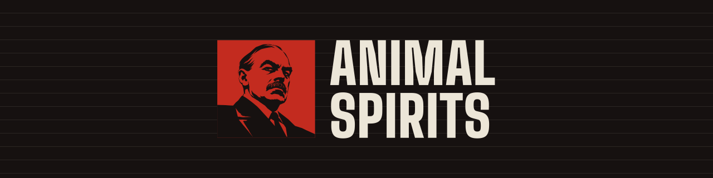

<picture>
  <source media="(prefers-color-scheme: light)" srcset="social/readme-banner-light.svg">
  
</picture>

# animal-spirits/brand

Source files for the Animal Spirits identity: logos, colour tokens, terminal and editor themes, and the type-on animation. The brand book explains when and how to use them. Every file here is generated by `src/`; change the code, not the outputs.

## What's here

| Path | Contents |
| --- | --- |
| `logo/` | Lockup, bar, wordmark and stacked wordmark, each `on-dark`, `on-light` and `mono` (currentColor) SVG; the block in three cuts; avatar, favicon SVG and ICO |
| `logo/png/` | PNG exports: avatar 256/512/1024, favicon 16 to 512, lockup, bar and wordmark at 1200 px |
| `social/` | README banners (dark, light), Open Graph card 1200×630, GitHub social preview 1280×640 |
| `cabinet/` | Eight engraved objects (globe, coins, dice, hourglass, bowler, balance, ledger, ship) in ink (currentColor) and in the red block; `hat.svg` for the Crowd |
| `woodcuts/` | Generated woodcuts from `data/cuts/`, traced into three cuts, ink and block |
| `patterns/` | Utility (quiet, dark and light panels) and Crowd (loud, repeatable tiles and panels) |
| `devices/` | Rubber stamps (currentColor) and ticker tape; footnote and ledger-table styles are in `tokens/devices.css` |
| `social/lexicon/` | The Lexicon: thirty 1080×1350 cards; the list is `LEXICON.md` |
| `motion/` | `typeon.svg` (block, then the name letter by letter), `ident.html` and `ident-game.html` (1.6 s ident; 1080p mp4 renders beside them), `splash.sh` (CLI splash) |
| `site/` | One-page studio site, `uv run scripts/site.py`: `index.html` whole, `body.html` without the document shell |
| `tokens/` | `tokens.css` (custom properties, dark first) and `tokens.json` (Design Tokens format) |
| `themes/` | Ghostty, Alacritty, Kitty, WezTerm, Windows Terminal, VS Code (also loads in Shiki) and Neovim |
| `book/` | `animal-spirits-brand-book.pdf`: name, voice, logo, colour, type, motion, motifs, games, applications |
| `fonts/` | Which typefaces, where to get them, their licence |
| `src/` | The drawing code: the Keynes cuts, the letters and spacing, the engraver and cabinet scenes, patterns, devices, palette, writers |

## Use

- **Web:** `@import "tokens/tokens.css";` then `var(--as-bg)`, `var(--as-text)`, `var(--as-accent)` and so on. Set `data-theme="light"` or `"dark"` on `<html>` to override the system setting.
- **Favicon:** `<link rel="icon" href="/favicon.svg" type="image/svg+xml">` with `favicon.ico` as fallback and `favicon-180.png` as `apple-touch-icon`.
- **Ghostty:** copy `themes/ghostty/animal-spirits-ledger-dark` to `~/.config/ghostty/themes/`, then `theme = animal-spirits-ledger-dark`.
- **Alacritty:** `import = ["~/.config/alacritty/animal-spirits-ledger-dark.toml"]` under `[general]`.
- **Kitty:** `include animal-spirits-ledger-dark.conf`.
- **WezTerm:** put the file in a `color_schemes_dirs` folder, then `color_scheme = "Animal Spirits Ledger Dark"`.
- **Windows Terminal:** paste the schemes from `themes/windows-terminal/schemes.json` into `settings.json`.
- **VS Code:** copy `themes/vscode` to `~/.vscode/extensions/animal-spirits-ledger`, restart, pick Animal Spirits Ledger. Shiki: `import theme from "./themes/vscode/themes/animal-spirits-ledger-dark-color-theme.json"`.
- **Neovim:** copy `themes/nvim/colors/animal-spirits.lua` into `~/.config/nvim/colors/`, then `:colorscheme animal-spirits`. It follows `background`.
- **Devices:** `@import "tokens/devices.css";` after the tokens, then `<sup class="as-fn">1</sup>`, `<aside class="as-note">` and `<table class="as-ledger">` with the total row in `<tfoot>`. `class="as-utility"` puts the Utility ground behind a section.
- **Games:** the stamp is `logo/favicon.svg` at 16 to 24 px followed by "an animal spirits game" in IBM Plex Mono. The `--version` line reads `ceteris 0.1.0 · an animal spirits game`.

## Regenerate

```sh
uv run animal-spirits-brand                        # SVGs, tokens, themes
uv run --extra png playwright install chromium     # once
uv run --extra png scripts/export_png.py           # PNGs, ICO, social cards
uv run scripts/cabinet.py                          # cabinet objects, Crowd, woodcuts (slow: minutes)
uv run --extra png scripts/lexicon.py              # lexicon cards and LEXICON.md
uv run --extra png scripts/book.py                 # brand book PDF (after all of the above)
```

## Licence

Code, tokens and themes (`src/`, `scripts/`, `tokens/`, `themes/`) are MIT; see `LICENSE`. The theme writers and book layout are adapted from [zaofang/brand](https://github.com/zaofang/brand) (MIT). The logos, cabinet objects, woodcuts and the name Animal Spirits are trademarks: the files are public so you can refer to Animal Spirits correctly, under the rules in `TRADEMARK.md`. Fonts are under the SIL Open Font License; see `fonts/README.md`.
